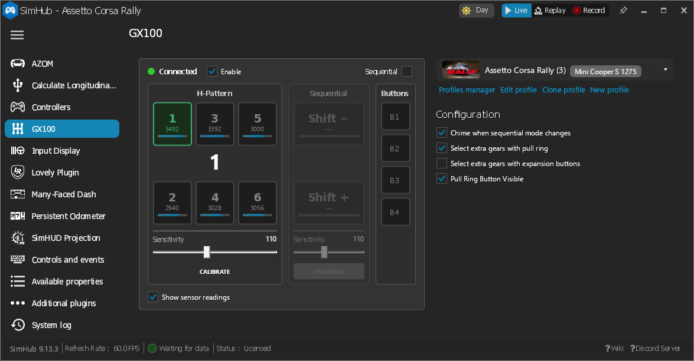

# GX100 SimHub Plugin

A [SimHub](https://www.simhubdash.com/) plugin that configures the GX100 USB shifter
(VID `0x04B0`, PID `0x5750`). Use it to change shifter settings from inside SimHub and
switch them automatically for each game.



## Features

- **Live status panel.** Shows connection state, the selected gear, sequential paddle
  state, the extra buttons, and optional Hall-sensor readings for each gear slot.
- **Device configuration**
  - H-pattern / sequential mode
  - H-pattern and sequential sensitivity (0–255)
  - Select extra gears with the pull ring
  - Select extra gears with the expansion buttons
  - Pull ring button visible
- **Calibration.** Start and finish H-pattern and sequential calibration from the panel.
- **Per-game profiles.** Use SimHub's standard profile system. When you switch games, the
  plugin applies that game's profile and sends it to the shifter. Each profile holds the
  sequential mode and the three gear/button options. Sensitivity is a hardware setting, so
  it is global and does not change between profiles.
- **Mode chime.** An optional short sound plays when the shifter changes between
  H-pattern and sequential, so you don't have to look away from the road.
- **Auto-reconnect.** The plugin checks for the shifter every 5 seconds. Settings changed
  while the shifter is unplugged are sent when it connects.

## Installation

1. Download `GX100Plugin.dll` from the
   [latest release](https://github.com/giantorth/gx100-simhub-plugin/releases/latest),
   or build it yourself (see below).
2. Close SimHub.
3. Copy `GX100Plugin.dll` into your SimHub install folder (the folder that contains
   `SimHubWPF.exe`).
4. Start SimHub. When it asks about the new plugin, enable it. **GX100** then shows up in
   the left menu.

## Usage

Open **GX100** in the SimHub left menu. Changes you make in the panel go to the shifter
right away and are saved to the active profile.

To set up a different configuration for each game, use the profile dropdown at the top
right (**Profiles manager**, **New profile**, **Clone profile**). SimHub selects the
profile for the game that is running.

### Actions

You can bind these under **Controls and events** to a wheel button or switch, to change
mode during a session:

| Action | Effect |
| --- | --- |
| `GX100.SequentialModeToggle` | Switch between H-pattern and sequential |
| `GX100.SequentialModeOn` | Switch to sequential mode |
| `GX100.SequentialModeOff` | Switch to H-pattern mode |

An action changes only the current mode. It does not change the saved profile, so the next
profile that is applied (for example, on a game switch) sets the mode again. For the first
10 seconds after the plugin loads, actions are ignored. This stops SimHub from replaying a
latching switch's state on startup and overriding the game's profile.

### Properties

You can use these in dashboards, overlays, and formulas:

| Property | Description |
| --- | --- |
| `GX100.Connected` | Shifter is connected |
| `GX100.CurrentGear` | `-1` reverse, `0` neutral, `1`–`8` gear |
| `GX100.GearName` | `R`, `N`, or the gear number |
| `GX100.SequentialMode` | Sequential mode is active |
| `GX100.SeqUp` / `GX100.SeqDown` | Sequential lever pulled / pushed |
| `GX100.Button1` … `GX100.Button5` | Extra buttons |
| `GX100.Sensor1` … `GX100.Sensor6` | Raw 12-bit Hall-sensor reading under each gear slot |

## Building

Requirements: the .NET SDK. The project targets .NET Framework 4.8 (x86) and builds
through the `Microsoft.NETFramework.ReferenceAssemblies` package, so it also builds on
Linux.

```sh
dotnet build -c Release
```

The output is `bin/x86/Release/GX100Plugin.dll`. To copy it into SimHub after each build,
set `SIMHUB_PATH` to your SimHub install folder:

```sh
dotnet build -c Release -p:SIMHUB_PATH="C:\Program Files (x86)\SimHub\"
```

The SimHub assemblies that the build references are in `libs/SimHub/`. `libs/SimHub/VERSION`
gives the SimHub version they came from.

## Releases

GitHub Actions builds the plugin on Windows:

- **Build** (`.github/workflows/build.yml`) runs on every push to `main` and on every
  pull request that changes source. The DLL is attached to the run as an artifact.
- **Release** (`.github/workflows/release.yml`) runs when you push a `v*` tag. It builds
  the DLL with the tag as its version, then publishes a GitHub release with
  `GX100Plugin.dll`, a zip of it, and generated release notes.
- **SimHub deps update** (`.github/workflows/simhub-update.yml`) checks every day for a
  new SimHub release. When there is one, it installs SimHub on a Windows runner, copies
  the DLLs into `libs/SimHub/`, checks that the plugin still builds, and opens a PR.

To make a release:

```sh
git tag v0.2.0
git push origin v0.2.0
```

A tag with a suffix such as `v0.2.0-beta.1` is published as a pre-release.

## Project layout

| Path | Contents |
| --- | --- |
| `GX100Plugin.cs` | Plugin entry point: properties, actions, connection, profile handling |
| `GX100Defaults.cs` | Default values and valid ranges for every setting |
| `ModeChime.cs` | Synthesised mode-change chime |
| `Protocol/` | HID report layout and the HidSharp connection |
| `Telemetry/` | Live device and input state |
| `UI/` | Settings panel, persisted settings, profile model and store |

## Protocol notes

The shifter uses unnumbered 64-byte HID output reports:

- **Calibration** `[0x01, cmd]`, where `cmd` is `0x01`/`0x02` (H-pattern start/finish) or
  `0x03`/`0x04` (sequential start/finish).
- **Configuration** `[0x02, combo1, combo2, seq_mode, h_sens, 0x00, seq_sens, 0x00, pull_btn]`

Input reports are 16 bytes: two bytes of button bits, then six 12-bit big-endian
Hall-sensor values in bytes 3–14. The shifter sends one about every 56 ms. See
`Protocol/GX100Protocol.cs` for the bit assignments.
